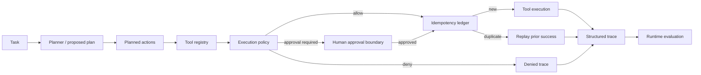

# Agentic AI Workbench

[](https://github.com/cagataykavas/agentic-ai-workbench/actions/workflows/ci.yml)

An inspectable workbench for **tool-using AI workflows with explicit execution authority**. The project separates planning from execution and makes tool risk, approvals, idempotency, bounded steps, traces and evaluation visible in ordinary Python rather than hiding them inside an agent framework.

This repository complements the more specialized [Agentic Migrator](https://github.com/cagataykavas/agentic-migrator): the Migrator is a code-migration product; this workbench is a compact reference implementation for general agent runtime patterns.

## Core design



The important boundary is simple:

> A planner may propose an action. The runtime independently decides whether that action is authorized to execute.

That prevents “the model chose a tool” from silently becoming “the model had permission to cause the side effect.”

## Implemented runtime patterns

### Explicit tool contracts

A `ToolSpec` records:

- name and description;
- Python handler;
- optional argument validator;
- risk level: low / medium / high;
- side-effect class: none / reversible / irreversible;
- whether successful calls are safe to replay from an idempotency ledger.

### Policy before execution

`ToolPolicy` can:

- deny named tools;
- require approval for high-risk actions;
- require approval for irreversible side effects;
- optionally require approval for medium-risk or reversible operations.

The planner does not get to override this policy.

### Human approval boundary

Actions that require review enter `awaiting_approval` rather than being executed optimistically. A later runtime call can include the explicit approved action IDs.

This keeps a human-in-the-loop workflow concrete: approval is represented as execution state, not as a README sentence.

### Idempotent retries

Successful idempotent calls are stored using an explicit or deterministic SHA-256 idempotency key. The dependency executor additionally binds each key to the canonical tool-and-arguments digest, so a changed request cannot receive a stale replay. Equivalent retries return `replayed` with the previous output instead of repeating the side effect. An optional standard-library SQLite ledger preserves these decisions across process restarts while keeping the in-memory default convenient for tests.

The SQLite adapter also claims new work before tool dispatch. One worker receives a monotonically
increasing fencing token; competitors fail closed without invoking the handler. Handlers can read
`get_current_fencing_token()` and forward the value to a dependency that supports conditional
writes. Expired leases and post-dispatch failures become `unknown` rather than being retried
optimistically. Recovery therefore requires either a trusted external success receipt or an
explicit authorization to retry with the next fencing token.

External success receipts can be authenticated with HMAC-SHA256 before reconciliation. The
signed envelope binds the idempotency key, canonical request digest, fencing token, canonical
output, issue time and rotation key ID. Verification rejects stale, future-dated, malformed,
oversized, unknown-key or modified receipts before the ledger transaction. The matching unknown
claim then consumes the receipt atomically, so concurrent delivery produces one terminal result
without redispatching the tool.

The opposite reconciliation decision is authenticated as well. A retry authorization proves that
the exact unknown claim did **not** commit its side effect and binds the current fencing token plus
the permitted next lease duration into a domain-separated HMAC envelope. The SQLite ledger verifies
the envelope before atomically advancing to the next token; 64 concurrent deliveries still produce
one retry owner. A stale, edited, cross-protocol or wrong-claim authorization cannot reopen work.
Each claim additionally persists a bounded retry allowance and consumes it in the same SQLite
transaction as the fencing-token advance. A replacement process cannot loosen that claim's policy,
and an exhausted claim remains blocked even when presented with an authentic authorization.
The ledger also exports key-free gauges and durable low-cardinality counters for unknown transitions,
authorized retries and budget exhaustion; those counters commit in the same transaction as the
corresponding claim state.

An authoritative reconciliation coordinator can query a downstream system of record before either
path is authorized. It requires an exact claim identity echo, fresh bounded observation and supported
outcome: `committed` produces a signed success receipt, `not_committed` produces one signed retry
authorization, and `pending` produces no authority. Late, stale, contradictory or mismatched provider
responses fail closed. A standard-library HTTPS adapter pins the endpoint, builds a mutually
authenticated TLS context from CA/client key material, forwards the coordinator deadline to the
socket, bounds every response read and accepts only strict UTF-8 JSON with the documented schema.

This is useful for agent systems because transport retries, duplicated messages and repeated model plans should not automatically duplicate downstream writes.

### Bounded execution

Every runtime has a `max_steps` budget. Planned actions beyond the budget are surfaced as `skipped_budget` in the trace instead of disappearing.

### Structured traces

Every action records:

```text
action ID
tool
status
output / error
policy decision + reason
idempotency key
```

The trace also records why execution stopped. It can be serialized to plain dictionaries/JSON for logging or experiment analysis.

## Runtime evaluation

`src/runtime_eval.py` summarizes a trace with operational metrics:

- success rate;
- tool failure rate;
- approval rate;
- denial rate;
- idempotent replay rate;
- budget-skip rate;
- whether the plan completed normally.

These metrics are intentionally about **agent workflow behavior**, not LLM eloquence.

## Example

```python
from src.governed_runtime import (
    GovernedAgentRuntime,
    PlannedAction,
    RiskLevel,
    SideEffect,
    ToolRegistry,
    ToolSpec,
)

registry = ToolRegistry()
registry.register(
    ToolSpec(
        name="lookup",
        description="Read a public record",
        handler=lambda args: {"record": args["id"], "status": "active"},
    )
)
registry.register(
    ToolSpec(
        name="publish",
        description="Publish an external change",
        handler=lambda args: {"published": args["release"]},
        risk=RiskLevel.HIGH,
        side_effect=SideEffect.IRREVERSIBLE,
    )
)

plan = [
    PlannedAction("read-1", "lookup", {"id": "A-17"}),
    PlannedAction("publish-1", "publish", {"release": "candidate-v2"}),
]

runtime = GovernedAgentRuntime(registry)
trace = runtime.execute("Inspect and publish candidate", plan)

# lookup -> succeeded
# publish -> awaiting_approval
print(trace.to_dict())
```

Approval is explicit:

```python
approved_trace = runtime.execute(
    "Inspect and publish candidate",
    plan,
    approved_action_ids=frozenset({"publish-1"}),
)
```

## Deterministic baseline

The earlier `src/core.py` / `src/demo.py` workflow remains in the repository as a small deterministic baseline with calculator/search tools and a transparent planner.

Run it with:

```bash
python -m src.demo
```

The newer `src/governed_runtime.py` layer exists to show how that simple tool loop changes once production concerns appear: authorization, side effects, duplicate execution and bounded operations.

## Human–agent workflow experiments

The repository also contains lightweight human-agent collaboration and workflow experiment examples used to explore:

- escalation policy;
- automation rate;
- human override behavior;
- task completion and decision-time trade-offs.

Those examples are kept separate from the runtime so service-design metrics do not become hard-coded into the execution engine.

## Repository map

```text
src/core.py                    original deterministic tool loop
src/demo.py                    local baseline demo
src/governed_runtime.py        policy, approvals, idempotency, bounded execution
src/dag_execution.py           validated dependency DAG execution
src/sqlite_ledger.py            restart-safe SQLite idempotency and operational snapshot adapter
src/reconciliation.py          authenticated unknown-outcome receipts
src/reconciliation_adapter.py  authoritative downstream status-to-receipt boundary
src/http_reconciliation_provider.py  bounded mTLS JSON provider adapter
tools/mtls_reconciliation_sandbox.py disposable live-TLS fault-injection endpoint
docs/retry-authorization.md    signed no-commit decisions and retry threat model
docs/ledger-observability.md    key-free gauges, durable counters and alerting boundary
docs/authoritative-reconciliation.md  provider contract, deadlines and trust boundary
src/runtime_eval.py            trace-level operational metrics
human_agent_collaboration.py   human/agent routing example
workflow_experiment.py         workflow comparison metrics
tests/                         executable runtime contracts
```

## CI

GitHub Actions validates the full public engineering surface:

- Ruff over the runtime, integration tooling, tests and earlier examples;
- policy/approval behavior;
- idempotent replay;
- fail-closed idempotency-key payload binding;
- restart-safe SQLite replay and concurrent terminal-result protection;
- 64-worker claim contention, fencing-token rotation and unknown-outcome reconciliation;
- restart-safe retry-budget exhaustion and legacy schema migration;
- key-free ledger gauges and atomic unknown/retry/exhaustion counters;
- authoritative committed/not-committed/pending reconciliation decisions;
- pinned mTLS provider requests and fail-closed HTTP/JSON response validation;
- live CA/server/client certificate generation, mutual-TLS handshake and timeout-after-observation;
- execution budget handling;
- trace evaluation;
- deterministic demo smoke test;
- packaged runtime import.

No external model API is required for CI.

## What this repo does not claim

- The deterministic planner is not marketed as a general reasoning model.
- Idempotency does not make arbitrary irreversible tools safe.
- Approval requirements are reference policy patterns, not a universal risk taxonomy.
- The workbench does not grant an LLM unrestricted shell/network authority.
- Framework independence is deliberate; LangGraph, AutoGen or another orchestration layer could sit above the same execution-policy concepts.

## Natural extensions

- typed JSON-schema tool arguments;
- durable trace/event store;
- async tools with deadlines and cancellation;
- per-tool concurrency/bulkhead limits;
- per-tool circuit breakers and fleet-wide retry rate limits;
- OpenTelemetry spans;
- planner adapters for OpenAI-compatible models;
- offline agent trajectory evaluation and replay.

## Interview topics

**agentic AI · tool calling · planning vs execution · policy gates · human approval · idempotency · bounded agents · structured traces · retries · side effects · agent evaluation · human-in-the-loop · deterministic baselines · CI.**
