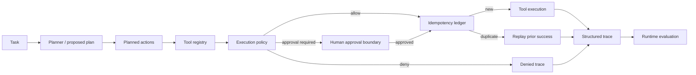

# Agentic AI Workbench

[](https://github.com/cagataykavas/agentic-ai-workbench/actions/workflows/ci.yml)

An inspectable workbench for **tool-using AI workflows with explicit execution authority**. The project separates planning from execution and makes tool risk, approvals, idempotency, bounded steps, traces and evaluation visible in ordinary Python rather than hiding them inside an agent framework.

This repository complements the more specialized [Agentic Migrator](https://github.com/cagataykavas/agentic-migrator): the Migrator is a code-migration product; this workbench is a compact reference implementation for general agent runtime patterns.

## Core design



The important boundary is simple:

> A planner may propose an action. The runtime independently decides whether that action is authorized to execute.

That prevents “the model chose a tool” from silently becoming “the model had permission to cause the side effect.”

## Implemented runtime patterns

### Explicit tool contracts

A `ToolSpec` records:

- name and description;
- Python handler;
- optional argument validator;
- risk level: low / medium / high;
- side-effect class: none / reversible / irreversible;
- whether successful calls are safe to replay from an idempotency ledger.

### Policy before execution

`ToolPolicy` can:

- deny named tools;
- require approval for high-risk actions;
- require approval for irreversible side effects;
- optionally require approval for medium-risk or reversible operations.

The planner does not get to override this policy.

### Human approval boundary

Actions that require review enter `awaiting_approval` rather than being executed optimistically. A later runtime call can include the explicit approved action IDs.

This keeps a human-in-the-loop workflow concrete: approval is represented as execution state, not as a README sentence.

### Idempotent retries

Successful idempotent calls are stored using an explicit or deterministic SHA-256 idempotency key. Both the basic governed runtime and the dependency executor use one strict canonical-request type and bind every key to the same tool-and-arguments digest, so an explicit key reused with a changed request fails before tool dispatch instead of receiving a stale replay. NaN, infinity, non-object and oversized arguments fail before dispatch; equivalent JSON objects with reordered keys still replay the previous output without repeating the side effect. An optional standard-library SQLite ledger preserves these request bindings across process restarts while keeping the in-memory default convenient for tests.

The SQLite adapter also claims new work before tool dispatch. One worker receives a monotonically
increasing fencing token; competitors fail closed without invoking the handler. Handlers can read
`get_current_fencing_token()` and forward the value to a dependency that supports conditional
writes. Expired leases and post-dispatch failures become `unknown` rather than being retried
optimistically. Recovery therefore requires either a trusted external success receipt or an
explicit authorization to retry with the next fencing token.

External success receipts can be authenticated with HMAC-SHA256 before reconciliation. The
signed envelope binds the idempotency key, canonical request digest, fencing token, canonical
output, issue time and rotation key ID. Verification rejects stale, future-dated, malformed,
oversized, unknown-key or modified receipts before the ledger transaction. The matching unknown
claim then consumes the receipt atomically, so concurrent delivery produces one terminal result
without redispatching the tool.

The opposite reconciliation decision is authenticated as well. A retry authorization proves that
the exact unknown claim did **not** commit its side effect and binds the current fencing token plus
the permitted next lease duration into a domain-separated HMAC envelope. The SQLite ledger verifies
the envelope before atomically advancing to the next token; 64 concurrent deliveries still produce
one retry owner. A stale, edited, cross-protocol or wrong-claim authorization cannot reopen work.
Each claim additionally persists a bounded retry allowance and consumes it in the same SQLite
transaction as the fencing-token advance. A replacement process cannot loosen that claim's policy,
and an exhausted claim remains blocked even when presented with an authentic authorization.
The ledger also exports key-free gauges and durable low-cardinality counters for unknown transitions,
authorized retries and budget exhaustion; those counters commit in the same transaction as the
corresponding claim state.

An authoritative reconciliation coordinator can query a downstream system of record before either
path is authorized. It requires an exact claim identity echo, fresh bounded observation and supported
outcome: `committed` produces a signed success receipt, `not_committed` produces one signed retry
authorization only when its authority epoch and durable sequence or replica proof satisfy an explicit
policy, and `pending` produces no authority. Late, stale, under-proven, contradictory or mismatched
provider responses fail closed. A standard-library HTTPS adapter pins the endpoint, builds a mutually
authenticated TLS context from CA/client key material, forwards the coordinator deadline to the
socket, bounds every response read and accepts only strict UTF-8 JSON with the documented schema.
For deployments that keep claim state in PostgreSQL, `PostgresWalStatusProvider` instead reads the
exact claim and a protected authority epoch/sequence in one read-only snapshot. It refuses standbys
and primaries below the controller's minimum WAL watermark, and derives replica evidence only from
synchronous replicas that have replayed that watermark. Its thread-safe metrics snapshot exports
only fixed outcome/rejection counters and positive/negative WAL-margin readiness gauges—never DSNs, claim
identities, raw LSNs or replica identities. `SignedAuthorityEpochSource` can additionally re-read a
signed controller checkpoint for every negative decision, preventing a process-local epoch floor
from remaining authoritative after failover.

This is useful for agent systems because transport retries, duplicated messages and repeated model plans should not automatically duplicate downstream writes.

### Bounded execution

Every runtime has a `max_steps` budget. Planned actions beyond the budget are surfaced as `skipped_budget` in the trace instead of disappearing.

### Structured traces

Every action records:

```text
action ID
tool
status
output / error
policy decision + reason
idempotency key
```

The trace also records why execution stopped. It can be serialized to plain dictionaries/JSON for logging or experiment analysis.

## Runtime evaluation

`src/runtime_eval.py` summarizes a trace with operational metrics:

- success rate;
- tool failure rate;
- approval rate;
- denial rate;
- idempotent replay rate;
- budget-skip rate;
- whether the plan completed normally.

These metrics are intentionally about **agent workflow behavior**, not LLM eloquence.

For benchmark or release decisions, `evaluate_traces` validates a bounded set of complete runtime
traces before applying one prespecified `RuntimeGatePolicy`:

```python
from src.runtime_eval import RuntimeGatePolicy, evaluate_traces

policy = RuntimeGatePolicy(
    minimum_planned_actions=500,
    minimum_success_rate=0.90,
    maximum_failure_rate=0.02,
    maximum_denial_rate=0.01,
    maximum_budget_skip_rate=0.01,
    minimum_completed_trace_rate=0.95,
)
report = evaluate_traces(benchmark_traces, policy)
if not report.passed:
    raise RuntimeError(report.violations)
```

The gate rejects missing or duplicate action results, unsupported stop reasons, inconsistent
budget-stop evidence, unbounded input sets and non-finite thresholds. Its report contains only
aggregate counts, rates and stable violation codes—never tasks, tool names, arguments, outputs,
errors, policy reasons or idempotency keys. Every report commits to the exact threshold policy with
a domain-separated SHA-256. Aggregate report objects also revalidate count totals, exact rates,
completed-trace granularity, policy digests, and canonical violation ordering whenever a manifest
signer or verifier crosses the trust boundary. Rates are exact descriptive aggregates: the gate
does not claim statistical independence, uncertainty bounds or representativeness of the supplied
benchmark set.

`src/runtime_eval_manifest.py` can recompute a report from runtime traces and bind it to the
reviewed scenario-suite digest, privacy-reduced evaluation evidence, runtime version and source
revision before a release gate consumes it:

```python
from src.runtime_eval_manifest import (
    dump_runtime_benchmark_manifest,
    evaluate_and_sign_runtime_benchmark,
    evaluate_and_verify_runtime_benchmark,
)

report, manifest = evaluate_and_sign_runtime_benchmark(
    benchmark_traces,
    policy,
    scenario_suite_sha256=scenario_suite_sha256,
    runtime_version="agent-runtime-0.2.0",
    source_revision=source_revision,
    key_id="benchmark-signing-v1",
    secret=signing_secret,
)
serialized = dump_runtime_benchmark_manifest(manifest)
verified_report, manifest_commitment = evaluate_and_verify_runtime_benchmark(
    benchmark_traces,
    policy,
    manifest,
    expected_scenario_suite_sha256=scenario_suite_sha256,
    expected_runtime_version="agent-runtime-0.2.0",
    expected_source_revision=source_revision,
    keyring={"benchmark-signing-v1": verification_secret},
)
```

The high-level signer hashes the gate-relevant trace structure before and after evaluation and
fails closed if it changes, so callers cannot attach an arbitrary report or unrelated trace-evidence
digest. The evidence commitment includes trace ordering, stop reasons, action identifiers,
statuses, policy decisions and whether outputs/errors are present. It deliberately excludes tasks,
tool names, payload values, error text, policy reasons and idempotency keys. Different private
payloads with the same operational shape therefore share an evidence digest; retain the underlying
benchmark artifact under appropriate access controls when content-level auditability is required.

The bounded canonical JSON loader rejects duplicate, unknown and non-canonical manifest fields.
The signed manifest carries only aggregate values and cryptographic commitments, so private traces
stay outside the release artifact. Its HMAC-SHA256 signature is a shared-secret authenticity
boundary—not public-key provenance. Protect and rotate the signing key, review how the
scenario-suite digest is produced, and use a separate artifact-attestation system when independent
verification is required.

`tools/verify_runtime_benchmark_attestation.py` provides that independent intake boundary for a
canonical runtime manifest that has been attested with GitHub artifact attestations. The verifier
checks the exact expected manifest digest, immutable signer workflow commit and branch, and denies
self-hosted runners. It verifies a private snapshot of the manifest so a concurrent file replacement
cannot change the artifact under inspection. The emitted receipt contains only commitments and
verification status, not repository or workflow names:

```bash
python tools/verify_runtime_benchmark_attestation.py runtime-benchmark-manifest.json \
  --expected-manifest-sha256 "$MANIFEST_SHA256" \
  --repository cagataykavas/agentic-ai-workbench \
  --signer-workflow .github/workflows/attest-runtime-benchmark.yml \
  --signer-digest "$SIGNER_WORKFLOW_COMMIT_SHA" \
  --source-ref refs/heads/main \
  --acceptance-history runtime-benchmark-acceptance-history.jsonl \
  --output runtime-benchmark-attestation-receipt.json
```

For an air-gapped decision, also supply `--bundle`, `--trusted-root` and the immutable numeric
`--repository-id`. Offline verification rejects every attestation result whose certificate does not
match that repository ID.

When `--acceptance-history` is supplied, the verifier appends only after provenance verification
succeeds. The owner-only JSONL log binds each privacy-reduced receipt to the previous entry and
serializes concurrent writers with an advisory file lock. Replaying the same receipt is idempotent;
deletion, reordering, field substitution, non-canonical JSON, truncated writes, symlinks, hard links,
and group/world-readable history files fail closed.

After a protected append, `create_attestation_history_checkpoint` can pass the canonical history
head to an injected HSM/KMS signer. Its Ed25519 envelope binds the entry count and terminal chain
digest to the accepted policy and manifest commitments, source revision, checkpoint-key identity,
and issuance time. Retain that small envelope outside the history host, then verify it against the
current file with an out-of-band public-key pin:

```bash
python tools/verify_runtime_benchmark_history_checkpoint.py \
  runtime-benchmark-acceptance-history.jsonl \
  retained-history-checkpoint.json \
  --source-revision "$GITHUB_SHA" \
  --checkpoint-key-id runtime-benchmark-history-2026-11 \
  --checkpoint-public-key-sha256 "$CHECKPOINT_PUBLIC_KEY_SHA256"
```

Verification authenticates the checkpoint before evaluating its claims, revalidates the complete
local chain, and requires an exact current head and entry count. This exposes replacement with an
older, internally valid history. It does not prove that the supplied checkpoint is the newest one:
the envelope must be published or retained independently, issuance should be serialized with
history updates, and consumers must apply their own freshness and checkpoint-key rotation policy.

The producer boundary is `.github/workflows/attest-runtime-benchmark.yml`. It can run only from a
default-branch push, uses the protected `runtime-benchmark-signer` Environment, and is the only job
granted OIDC and attestation permissions. Inside that boundary it runs the reviewed deterministic
suite in `src/reviewed_runtime_benchmark.py` against the real governed runtime. The suite exercises
successful reads, normalized tool failure, approval-required and approved side effects, explicit
policy denial, idempotent replay, step-budget exhaustion, and unknown-tool denial. It checks every
expected status and stop reason before applying prespecified aggregate thresholds, creating the
canonical manifest, and attesting that exact file.

Configure `RUNTIME_BENCHMARK_SIGNING_SECRET` as an Environment secret with at least 32 bytes and
require reviewers on `runtime-benchmark-signer` before enabling the default-branch job. The secret
is read only from the environment and never passed on the command line or written to the manifest.
The manifest and console receipt contain aggregate counts and commitments rather than tasks, tool
names, arguments, outputs, errors, policy reasons, or idempotency keys. The attested manifest is
retained for 30 days.

This controlled suite proves deterministic runtime-policy behavior, not LLM answer quality,
benchmark representativeness, runner attestation, or model performance. The HMAC key remains a
shared secret, and no live attestation is claimed until the workflow runs after review on the
protected default branch. The next hardening step is publishing signed checkpoints to transparent
or object-locked storage with an explicit checkpoint-key status and rotation policy.

## Example

```python
from src.governed_runtime import (
    GovernedAgentRuntime,
    PlannedAction,
    RiskLevel,
    SideEffect,
    ToolRegistry,
    ToolSpec,
)

registry = ToolRegistry()
registry.register(
    ToolSpec(
        name="lookup",
        description="Read a public record",
        handler=lambda args: {"record": args["id"], "status": "active"},
    )
)
registry.register(
    ToolSpec(
        name="publish",
        description="Publish an external change",
        handler=lambda args: {"published": args["release"]},
        risk=RiskLevel.HIGH,
        side_effect=SideEffect.IRREVERSIBLE,
    )
)

plan = [
    PlannedAction("read-1", "lookup", {"id": "A-17"}),
    PlannedAction("publish-1", "publish", {"release": "candidate-v2"}),
]

runtime = GovernedAgentRuntime(registry)
trace = runtime.execute("Inspect and publish candidate", plan)

# lookup -> succeeded
# publish -> awaiting_approval
print(trace.to_dict())
```

Approval is explicit:

```python
approved_trace = runtime.execute(
    "Inspect and publish candidate",
    plan,
    approved_action_ids=frozenset({"publish-1"}),
)
```

## Deterministic baseline

The earlier `src/core.py` / `src/demo.py` workflow remains in the repository as a small deterministic baseline with calculator/search tools and a transparent planner.

Run it with:

```bash
python -m src.demo
```

The newer `src/governed_runtime.py` layer exists to show how that simple tool loop changes once production concerns appear: authorization, side effects, duplicate execution and bounded operations.

## Human–agent workflow experiments

The repository also contains lightweight human-agent collaboration and workflow experiment examples used to explore:

- escalation policy;
- automation rate;
- human override behavior;
- task completion and decision-time trade-offs.

Those examples are kept separate from the runtime so service-design metrics do not become hard-coded into the execution engine.

## Repository map

```text
src/core.py                    original deterministic tool loop
src/demo.py                    local baseline demo
src/governed_runtime.py        policy, approvals, idempotency, bounded execution
src/dag_execution.py           validated dependency DAG execution
src/request_identity.py        shared strict canonical tool-request identity
src/sqlite_ledger.py            restart-safe SQLite idempotency and operational snapshot adapter
src/sqlite_binding_migration.py backup-first reviewed legacy-binding migration
src/reconciliation.py          authenticated unknown-outcome receipts
src/reconciliation_adapter.py  authoritative downstream status-to-receipt boundary
src/http_reconciliation_provider.py  bounded mTLS JSON provider adapter
src/postgres_reconciliation_provider.py  PostgreSQL primary/WAL reconciliation adapter
src/authority_epoch_checkpoint.py  signed, externally anchored controller epoch source
src/postgres_authority_checkpoint_store.py  serializable checkpoint CAS and atomic loader
tools/mtls_reconciliation_sandbox.py disposable live-TLS fault-injection endpoint
tools/replicated_status_model.py deterministic acknowledged-write failover model
tools/postgres_authority_failover_drill.py PostgreSQL promotion drill and offline evidence-chain audit
tools/migrate_sqlite_bindings.py private reviewed-mapping migration CLI
deploy/postgres-failover/     disposable PostgreSQL 17 primary/standby topology
docs/retry-authorization.md    signed no-commit decisions and retry threat model
docs/ledger-observability.md    key-free gauges, durable counters and alerting boundary
docs/authoritative-reconciliation.md  provider contract, deadlines and trust boundary
src/runtime_eval.py            trace metrics and bounded aggregate release gate
src/runtime_eval_manifest.py   authenticated benchmark and release provenance manifest
src/runtime_eval_attestation.py  independent GitHub attestation intake boundary
src/runtime_eval_attestation_history.py  locked hash-chained accepted-manifest history
src/runtime_eval_attestation_checkpoint.py  independently signable history-head checkpoint
src/reviewed_runtime_benchmark.py  deterministic governed-runtime release scenario suite
tools/sign_reviewed_runtime_benchmark.py  protected signer and canonical manifest CLI
tools/verify_runtime_benchmark_attestation.py  attestation verification and receipt CLI
tools/verify_runtime_benchmark_history_checkpoint.py  pinned Ed25519 checkpoint verifier
human_agent_collaboration.py   human/agent routing example
workflow_experiment.py         workflow comparison metrics
tests/                         executable runtime contracts
```

## CI

GitHub Actions validates the full public engineering surface:

- Ruff over the runtime, integration tooling, tests and earlier examples;
- policy/approval behavior;
- idempotent replay;
- fail-closed idempotency-key payload binding;
- cross-runtime canonical request identity and aggregate-only legacy binding inventory;
- backup-first exact-coverage migration for reviewed legacy request bindings;
- restart-safe SQLite replay and concurrent terminal-result protection;
- 64-worker claim contention, fencing-token rotation and unknown-outcome reconciliation;
- restart-safe retry-budget exhaustion and legacy schema migration;
- key-free ledger gauges and atomic unknown/retry/exhaustion counters;
- authoritative committed/not-committed/pending reconciliation decisions;
- pinned mTLS provider requests and fail-closed HTTP/JSON response validation;
- replica-gated reconciliation commits, stale-promotion fault injection and proof-gated negative
  decisions over live mTLS;
- PostgreSQL primary-role, WAL-watermark and snapshot-consistent negative-proof derivation;
- synchronous authority-checkpoint replication, old-primary isolation, standby promotion and
  post-promotion CAS advancement on a disposable PostgreSQL 17 topology, followed by a database-free
  integrity, pairing and transition audit of the archived evidence chain;
- live CA/server/client certificate generation, mutual-TLS handshake and timeout-after-observation;
- execution budget handling;
- integrity-checked aggregate trace evaluation and prespecified release thresholds;
- deterministic demo smoke test;
- packaged runtime import.

No external model API is required for CI.

## What this repo does not claim

- The deterministic planner is not marketed as a general reasoning model.
- Idempotency does not make arbitrary irreversible tools safe.
- Approval requirements are reference policy patterns, not a universal risk taxonomy.
- The workbench does not grant an LLM unrestricted shell/network authority.
- Framework independence is deliberate; LangGraph, AutoGen or another orchestration layer could sit above the same execution-policy concepts.

## Natural extensions

- typed JSON-schema tool arguments;
- durable trace/event store;
- async tools with deadlines and cancellation;
- per-tool concurrency/bulkhead limits;
- per-tool circuit breakers and fleet-wide retry rate limits;
- OpenTelemetry spans;
- planner adapters for OpenAI-compatible models;
- offline agent trajectory evaluation and replay.

## Interview topics

**agentic AI · tool calling · planning vs execution · policy gates · human approval · idempotency · bounded agents · structured traces · retries · side effects · agent evaluation · human-in-the-loop · deterministic baselines · CI.**


